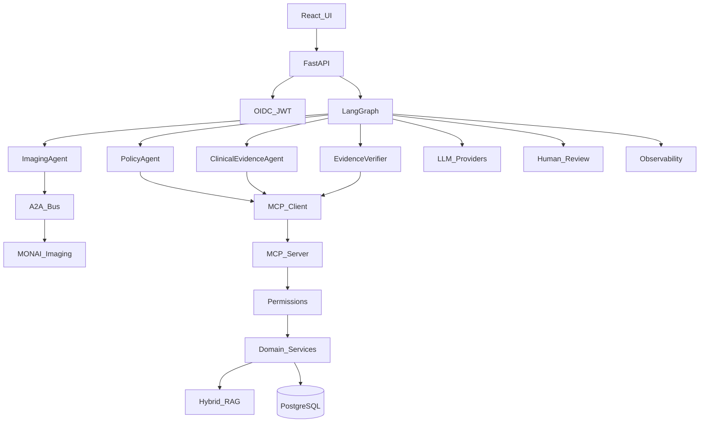

# HealthEvidence AI

**What it is for:** **prior-auth evidence prep** (insurance paperwork) on top of a **lifelong digital health record across hospitals**.

It is a **safety-conscious prototype for organizing prior-authorization checklists**, not a clinical AI and not a “perfect model.” In the default setup, evidence checking is **mostly deterministic rules** (keyword/lab matching, negation, units). Optional AI (Ollama or a cloud model) only runs when you turn it on, and cloud models are blocked once real patient data is enabled without attestation. Desk copy labels **rule check** vs **AI check** honestly.

1. **Records / PA staff** prepare evidence packets when payers need documentation readiness — gaps ranked, staff minutes estimated, senior handoff ready.
2. **Seniors** final-acknowledge Reviews; residents may check evidence but not final-sign.
3. **Patients** keep **My record**: surgeries, symptoms, injuries, treatments from many facilities so the next doctor sees the full story.
4. **Any clinician** (physio, surgeon, resident, senior) opens the same lifelong history for continuity of care.
5. **Visit notes** tag hospital + department so new care joins the lifelong chart.

It organizes evidence for paperwork. **It does not approve, deny, diagnose, or submit prior auth to a payer.** Clinical data arrives when staff type notes, paste FHIR, or use synthetic seed — there is no live EHR/HIS/ABDM feed yet.

Designed for **clinic → multispecialty → super-specialty → government/teaching** facilities. Set Facility + Role in the top bar — small clinics may switch hats; teaching hospitals keep resident draft / senior sign-off.

**Multi-specialty digital file:** visit notes and chart filters cover hospital departments including cardiology, ortho, oncology, OB/GYN, neurology, urology, surgery, and supporting labs/imaging/pharmacy.

**Practice path (any facility):**

| Role | Correct path |
|------|----------------|
| **Records / PA staff** | Patients → sticky banner (age/sex/DOB) → essentials → Prepare packet → Visit note gaps → handoff. |
| **Senior clinician** | Today → Reviews → Check evidence → acknowledge or send back. Visit note only if they document it. |
| **Resident / junior doctor** | Chart → packet → visit notes → may check evidence; escalate HITL to senior. |
| **Patient** | My record → lifelong history → Add visit note from any hospital |

**RBAC:** JWT roles `patient`, `staff`, `resident`, `senior_clinician`, `admin`. HITL resume = senior/admin only. Visit note = patient/staff/resident/senior. Packet prepare = staff/resident/senior. Legacy `reviewer` → senior.

Prepare packet never auto-acks clinician HITL. Visit note requires synthetic/consent attestation. Review runs persist for pause/resume. Help chat refuses coverage/diagnosis language. Ops metric: packet cycle time on Today and `GET /api/v1/metrics/ops`.

**Not for clinical use or diagnosis. Not a medical device.** Synthetic / consent-gated demo data only. Live PHI requires `ALLOW_PHI` + `PHI_PROGRAM_ATTESTED` under an accountable program.

## Who this is for (sales)

Sell as **prior-auth evidence prep + lifelong digital health record** — never as an approval engine or clinical AI. Lead with PA cycle-time reduction; lifelong chart is the continuity moat. Be explicit that default checklist scoring is rule-based.

| Buyer | Why they buy |
|-------|----------------|
| Hospital / health-system **PA coordinators & RCM** | Cut chart chase time before payer submission |
| High-PA **specialty groups** (ortho, oncology, cardiology, imaging) | Staff assemble packets across multi-specialty charts |
| **RCM / PA outsourcing** vendors | White-label prep desk for client practices |
| Health systems preparing for **CMS FHIR ePA (~2027)** | DTR-style evidence assembly before PAS submit |

Start with one specialty service line that already has dedicated PA staff, prove packet cycle-time drop, then expand hospital-wide.

## Architecture



Source diagram: [docs/architecture.mmd](docs/architecture.mmd)

## Stack

- **API:** FastAPI, SQLAlchemy, PostgreSQL (SQLite for local development)
- **Agents:** LangGraph orchestration, MCP tools, A2A messaging
- **RAG:** Dense + lexical retrieval, RRF fusion, reranking, citation preservation
- **LLM:** OpenAI, Anthropic, Gemini (Google GenAI `generateContent`), or Ollama (`/api/chat`) via `LLM_PROVIDER` — each keeps its own model env var (`GEMINI_MODEL_NAME` / `OLLAMA_MODEL_NAME`)
- **Imaging:** MONAI-isolated analysis path (non-diagnostic)
- **Auth:** OIDC in production; development JWT for local environments
- **UI:** React, TypeScript, Vite
- **Ops:** Docker Compose, Kubernetes manifests, evaluation suites

## Quick start

```bash
uv sync
cp .env.example .env
# Configure LLM_PROVIDER (local | ollama | openai | anthropic | gemini) and credentials as needed
# local = always-on grounded phrasing (pipeline runnable without a cloud/daemon LLM)

uv run python -m uvicorn app.main:app --reload --host 127.0.0.1 --port 8010
```

```bash
cd frontend && npm ci && npm run dev -- --host 127.0.0.1 --port 5173
```

Open [http://127.0.0.1:5173](http://127.0.0.1:5173) (Vite proxies `/api` → `8010`).

```bash
# Local / demo (your .env DATABASE_URL)
docker compose up --build

# Sales demo on pilot Postgres + synthetic seed
docker compose -f docker-compose.yml -f docker-compose.pilot.yml -f docker-compose.demo.yml up --build

make launch-check
make demo
make test
make eval-rag
make eval-agent
```

Paths: **Demo** vs **Pilot** vs staging — see [docs/LAUNCH.md](docs/LAUNCH.md) and [docs/PILOT_ROADMAP.md](docs/PILOT_ROADMAP.md).

## Configuration

See [`.env.example`](.env.example). Production and staging require:

- `AUTH_MODE=oidc` with issuer and JWKS URL
- Live `LLM_PROVIDER` with reachable credentials or Ollama
- `IMAGING_BACKEND=monai`
- PostgreSQL (`DATABASE_URL` must not use SQLite)

## Safety

Outputs are decision-support drafts over configured datasets. The system does not approve care, deny care, diagnose, or prescribe. Human review is required when evidence is missing or contradictory.

## Documentation

**Start here:** [docs/INDEX.md](docs/INDEX.md)

### Design

- [High-level design (HLD)](docs/HLD.md)
- [Low-level design (LLD)](docs/LLD.md)
- [Sequence flows](docs/SEQUENCE_FLOWS.md)
- [API overview](docs/API_OVERVIEW.md)
- [Data model](docs/DATA_MODEL.md)
- [Security design](docs/SECURITY_DESIGN.md)
- [Deployment design](docs/DEPLOYMENT.md)
- [Web UI design](docs/WEB_UI.md)
- [Architecture diagram](docs/architecture.mmd)

### Run / launch

- [Launch (demo vs pilot)](docs/LAUNCH.md)
- [Operations](docs/operations.md)
- [Kubernetes](docs/kubernetes.md)
- [OIDC pilot IdP wiring](docs/OIDC_PILOT.md)

### Roadmaps / gates

- [Pilot → production → demo roadmap](docs/PILOT_ROADMAP.md)
- [AI scope (hybrid decision-support)](docs/AI_SCOPE.md)
- [Live-ready go-live runbook](docs/LIVE_READY.md)
- [Production checklist](docs/PRODUCTION_CHECKLIST.md)
- [Safety and compliance notes](docs/clinical-product-roadmap.md)
- [Patient data privacy](docs/data-privacy.md)
- [OPD patient-wise ingest roadmap](docs/opd-ingest-roadmap.md)
- [Contributing](CONTRIBUTING.md)
- [Security](SECURITY.md)

## License

MIT. See [LICENSE](LICENSE).
