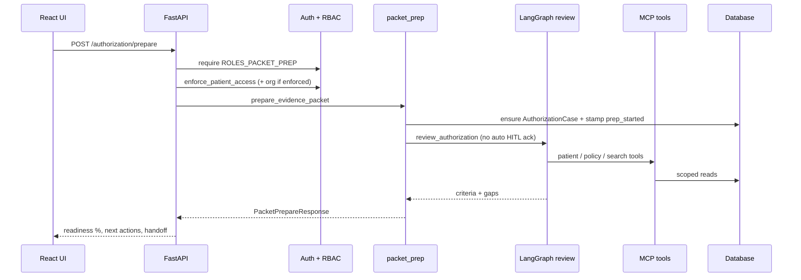
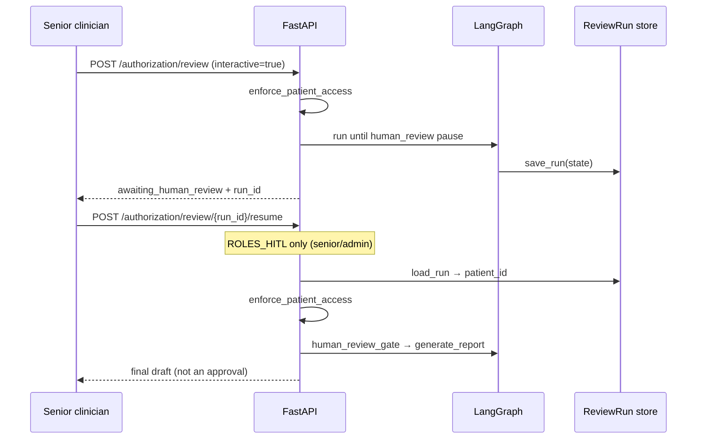
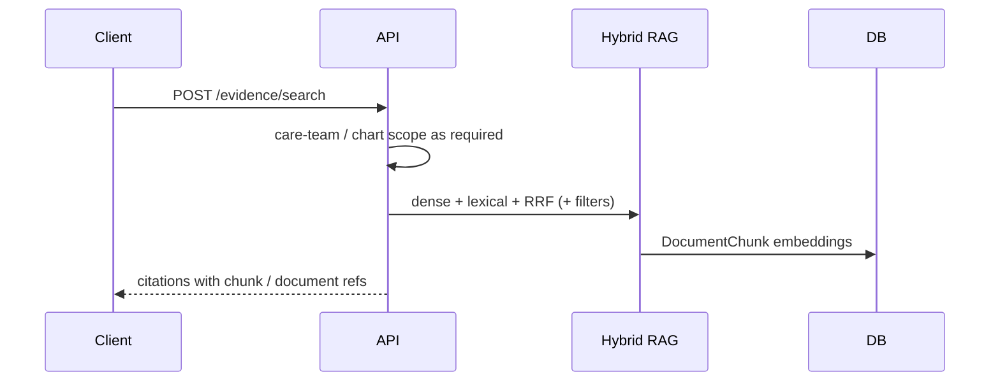
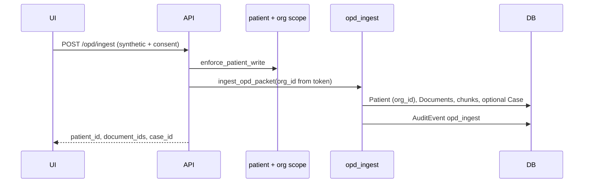
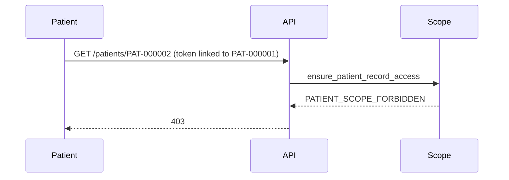
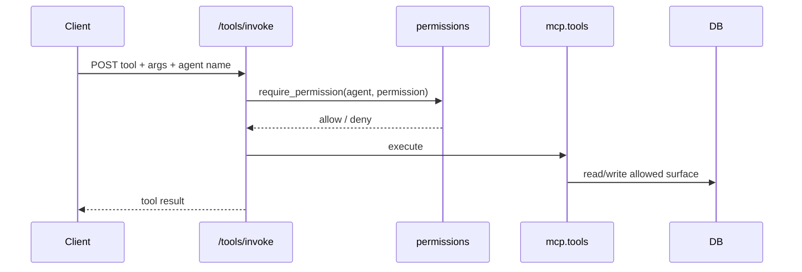

# Sequence flows

Runtime sequences as implemented. Mermaid diagrams are illustrative; OpenAPI and code are authoritative.

## 1. Packet prepare (staff / resident / senior)



## 2. Interactive review + HITL resume



Staff/resident resume → `403` (RBAC).

## 3. Evidence search



## 4. OPD / visit note ingest



FHIR path: `POST /opd/ingest/fhir` → map bundle → same ingest.

## 5. Patient self-scope



## 6. Org scope (when ENFORCE_ORG_SCOPE=true)

Care-team tokens must carry `org_id` or `org_code`. List/worklist/stats/ops/cases filter by patient org; chart open and writes call `ensure_org_patient_access`. Admin bypasses.

## 7. MCP tool invoke (HTTP)



## 8. Break-glass (admin)

```text
POST /security/break-glass { patient_id, reason }
  → require admin
  → AuditEvent action=break_glass (no clinical note body)
  → exportable via GET /audit/events
```

## Related

- [LLD.md](LLD.md) — node and service names
- [SECURITY_DESIGN.md](SECURITY_DESIGN.md) — role matrices
- [API_OVERVIEW.md](API_OVERVIEW.md) — path catalog
