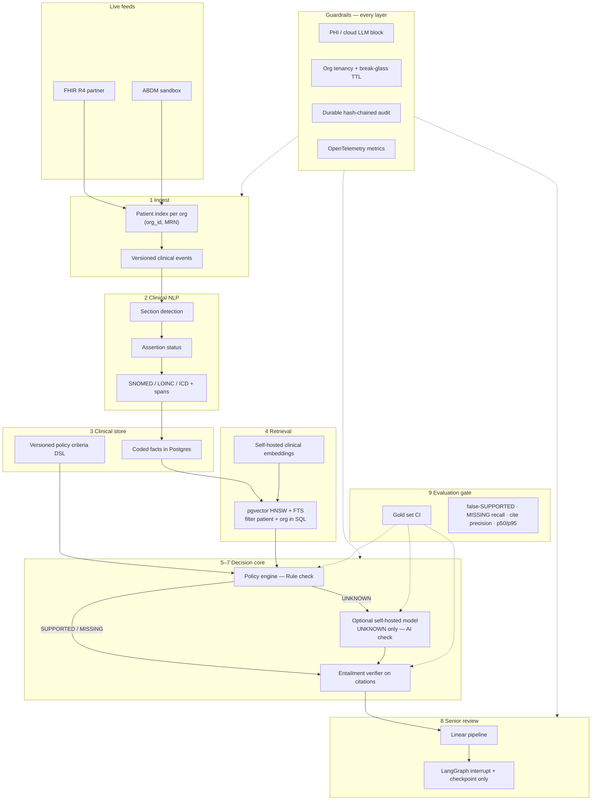

# Target architecture — prior-auth paperwork pilot

**Verdict:** Approve as an **administrative workflow pilot** after evaluation + retrieval work. Do **not** approve as an AI product until a gold-set gate exists.

Interactive explainer (open beside chat in Cursor): see the project canvas `target-architecture.canvas.tsx`.

## Flow (one hospital)



## Collapsed orchestration

`Policy load → Retrieve → Assess (rules ± model) → Verify (entailment) → Critic → Senior review`

Keep LangGraph **only** for the human-review pause. Remove the agent-to-agent bus until there is a real multi-agent need. Drop MCP-over-HTTP wrapping for the linear path.

## Today vs target (summary)

| Layer | Today | Target |
|-------|-------|--------|
| Ingest | Manual / pasted FHIR JSON | FHIR/ABDM adapter; per-org patient index |
| NLP | Regex + hand negation | Assertion NLP + codes + spans |
| Retrieval | Hash embeddings; rank then filter | pgvector + FTS; filter in query |
| Decision | Rules often labelled AI | Rules-first; model only for UNKNOWN |
| Grounding | Citation ID exists | Entailment on cited span |
| Orchestration | 13-node graph + A2A + MCP | Linear pipeline + HITL interrupt |
| Evaluation | 2+2 toy cases | 200+ criterion judgements / 50+ charts in CI |
| Imaging | Synthetic stub | Removed |

## 90-day plan

| Phase | Weeks | Deliverables |
|-------|-------|----------------|
| Measure | 1–4 | Gold set + CI gate; honest rule vs AI labels; remove imaging |
| Fix the core | 5–8 | pgvector pre-filter; clinical embeddings; entailment; assertion NLP; sequences; durable audit |
| Simplify & integrate | 9–12 | Linear pipeline; policy DSL; one real feed; one urban desk measuring minutes saved and false-SUPPORTED |

## Safety metric

**false-SUPPORTED rate** is the release gate. No model, prompt, or rule change ships without passing the gold set — separately for the rules path and each model path.

### Engineering seed (in repo now)

```bash
make eval-gold
# or: uv run python -m evaluation.run_gold --path rules
```

- Dataset: [`evaluation/gold/criteria_cases.v1.json`](../evaluation/gold/criteria_cases.v1.json) (`status: engineering_seed`, 32 criterion cases)
- Docs: [`evaluation/gold/README.md`](../evaluation/gold/README.md)
- CI runs the rules-path gate on every push; expand to dual-clinician gold (≥200 / ≥50 charts) before calling this an AI product
