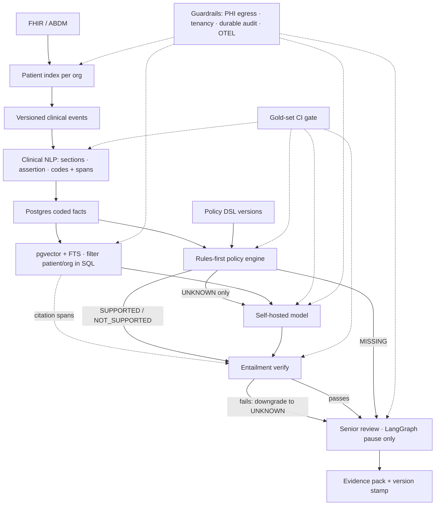

# Target architecture — prior-auth paperwork pilot

**Verdict:** Approve as an **administrative workflow pilot** after evaluation + retrieval work. Do **not** approve as an AI product until a gold-set gate exists.

Interactive explainer (open beside chat in Cursor): see the project canvas `target-architecture.canvas.tsx`.

## Flow (one hospital)



How to read it:

- **Rules first.** The policy engine scores every criterion from coded facts. Only `UNKNOWN` items go to the self-hosted model; `MISSING` goes straight to senior review (nothing to verify).
- **Every positive or negative claim is verified.** `SUPPORTED` / `NOT_SUPPORTED` from the rules and every model answer pass through the verifier against the cited spans from retrieval. A failed check never blocks the pack: the item is **downgraded to `UNKNOWN`** and flagged for the reviewer.
- **One human pause.** LangGraph is kept only for the senior-review interrupt; the output is an evidence pack stamped with the policy, rule, model and dataset versions used.
- **Gold set gates every scoring stage** (NLP assertion, rules, model, verifier), measured separately per path.
- **Guardrails** apply at ingest, retrieval, model and review: PHI egress block, org tenancy, durable audit, OpenTelemetry.

## Collapsed orchestration

`Policy load → Retrieve → Assess (rules ± model) → Verify (citations) → Critic → Senior review → Pack`

Keep LangGraph **only** for the human-review pause. Remove the agent-to-agent bus until there is a real multi-agent need. Drop MCP-over-HTTP wrapping for the linear path.

## Current vs target

| Layer | Current (in repo) | Target |
|-------|-------------------|--------|
| Ingest | Manual / pasted FHIR JSON | FHIR/ABDM adapter; per-org patient index; versioned events |
| NLP / assertion | Clause-scoped regex: negation, hedges (`unlikely`, `not confirmed`, `?`), family-history experiencer, whole-word matching | Clinical NLP: sections, assertion status, SNOMED / LOINC / ICD codes with spans |
| Facts | Notes + lab rows; units normalised (% ↔ mmol/mol), censored / pending / stale labs → `UNKNOWN` | Postgres coded facts |
| Retrieval | Hash embeddings + lexical fusion, patient filter before ranking | pgvector + FTS; patient/org filter in SQL |
| Decision | Rules-first; model path optional and labelled honestly | Rules-first; model only for `UNKNOWN` |
| Grounding / verify | **Lexical citation verifier** (`app/services/citation_check.py`): cited chunk must resolve to stored patient text and contain an affirmed rule phrase (or ≥2 informative description tokens for model-only criteria); else downgrade to `UNKNOWN` + reviewer note. **Interim stand-in for entailment**: it checks mention, not meaning, and does not yet check `NOT_SUPPORTED` items | Entailment (NLI) on cited span for `SUPPORTED` and `NOT_SUPPORTED` |
| Orchestration | 13-node graph + A2A + MCP | Linear pipeline + HITL interrupt |
| Evaluation | 98-case engineering seed (rules path): false-SUPPORTED rate over not-SUPPORTED cases, SUPPORTED / MISSING recall, citation presence, confusion counts | 200+ dual-clinician judgements / 50+ charts, per path, incl. verifier |
| Output | Review response + audit | Evidence pack with version stamp |
| Imaging | Synthetic stub | Removed |

## 90-day plan

| Phase | Weeks | Deliverables |
|-------|-------|----------------|
| Measure | 1–4 | Gold set + CI gate; honest rule vs AI labels; remove imaging |
| Fix the core | 5–8 | pgvector pre-filter; clinical embeddings; entailment; assertion NLP; sequences; durable audit |
| Simplify & integrate | 9–12 | Linear pipeline; policy DSL; one real feed; one urban desk measuring minutes saved and false-SUPPORTED |

## Safety metric

**false-SUPPORTED rate** (predicted `SUPPORTED` ÷ cases whose gold is not `SUPPORTED`) is the release gate, paired with **SUPPORTED recall** so the system cannot pass by refusing to support anything. No model, prompt, or rule change ships without passing the gold set — separately for the rules path and each model path.

### Engineering seed (in repo now)

```bash
make eval-gold
# or: uv run python -m evaluation.run_gold --path rules
```

- Dataset: [`evaluation/gold/criteria_cases.v1.json`](../evaluation/gold/criteria_cases.v1.json) (`status: engineering_seed`, 98 criterion cases)
- Docs: [`evaluation/gold/README.md`](../evaluation/gold/README.md)
- CI runs the rules-path gate on every push; expand to dual-clinician gold (≥200 / ≥50 charts) before calling this an AI product
